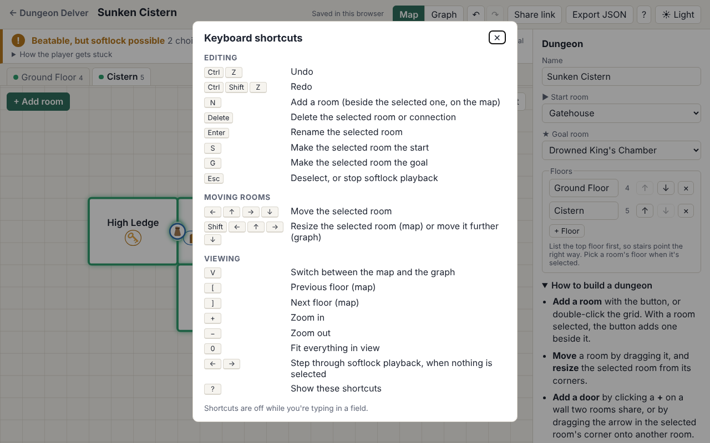
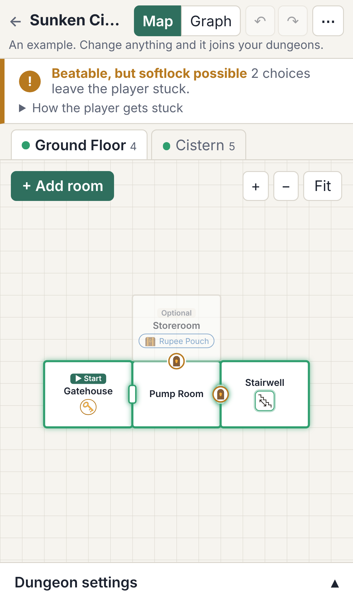
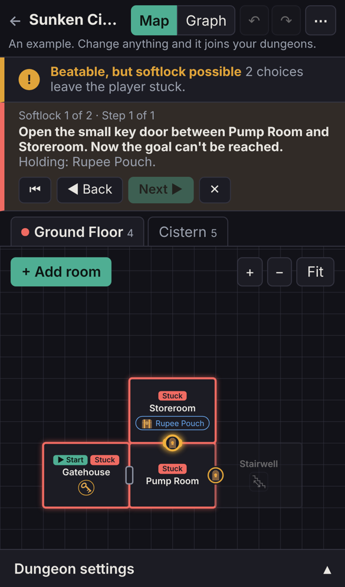

# Dungeon Delver

**[Open Dungeon Delver](https://nightmarethyu.github.io/dungeon-delver/)** · [Changelog](CHANGELOG.md) · [More of my projects](https://nightmarethyu.github.io/)

Find out whether a Zelda-style dungeon can be beaten before anyone plays it.

Sketch how a dungeon's rooms connect and what locks each connection: small keys, the big key, items like the hookshot, puzzles, and one-way drops. Dungeon Delver tells you whether the dungeon can be beaten, every way a player could softlock it, which rooms are optional, and what the critical path is. The results update as you edit, right on the map.

It's a static site on GitHub Pages, with no accounts and no server: dungeons are saved in your browser and shared as links. Version 1.1 adds undo, keyboard shortcuts, and a layout for phones. From here the plan is to grow it into a dungeon building tool for tabletop RPGs (see the [roadmap](#roadmap)).


## Try it

1. Open [the site](https://nightmarethyu.github.io/dungeon-delver/) and pick one of the three examples. The **Sunken Cistern** is a good start: it can be beaten, but two choices leave the player stuck.
2. Open "How the player gets stuck" in the banner and step through a softlock to see where it goes wrong.
3. Change something, like moving a key or locking a different door, and watch the results change. Press **?** for the keyboard shortcuts.
4. When you're ready, start a new dungeon from the front page. It saves itself as you go.

## Features

- **Lay out the dungeon as a map.** The builder opens on the map: one floor at a time, with rooms as rectangles on a snap grid. Drag rooms to move them, drag a corner to resize, and double-click the grid to add a room. Rooms connected on the same floor sit side by side with a door in their shared wall, marked with its lock's icon. Stairs and holes to other floors show inside their room, with arrows for one-way stairs; click one to jump to the room it leads to. Add a door by clicking the **+** on a shared wall or dragging the arrow in a selected room's corner onto another room, and when you put a room against another the map offers to add one. Rooms that have never been on the map are placed automatically, beside the rooms they connect to.
- **Room notes for the game master.** Each room has boxes for its description, enemies, traps and hazards, treasure, and hidden details, plus a plain notes box for anything else. They're free text and not tied to any game system, so stat blocks, DCs, or rolls from whatever game you run all fit. They travel with the dungeon in saves and share links.
- **More in a room than keys.** Besides small keys, the big key, and items, a room can hold treasure, enemies, traps, puzzles, characters, or a custom thing you name yourself, each with an optional detail like "3 goblins". These are for the game master: the solver ignores them, so they never lock anything. Any content's icon can be swapped for an emoji, picked from a list or typed in; the drawn icons stay the default.
- **Puzzle locks.** A connection can be locked by a puzzle solved inside one of its rooms, like a shutter that opens once you solve the room. It opens from that side only, then stays open both ways, so the solver can tell when a drop or a key choice leaves the player on the wrong side. A puzzle on the door itself (like a lockpicking minigame) can be solved from either side.
- **Or build it as a graph.** Switch from Map to Graph to add, rename, move, and delete rooms as nodes, and drag between them to connect them. The side panel edits a room's contents (small keys, the big key, named items) or a connection's lock (small key, big key, item, puzzle) and kind (door, stairs, drop, passage, one-way). Pick the start and goal rooms, and sort rooms into floors.
- **Undo and keyboard shortcuts.** Undo and redo any edit with the ↶ ↷ buttons or Ctrl+Z / Ctrl+Shift+Z (⌘ on a Mac). Press **?** in the builder for the full list: **N** adds a room, the arrow keys move the selected room (Shift+arrows resize it on the map), **Delete** removes it, **Enter** renames it, **S** and **G** make it the start or goal, **V** switches between map and graph, **[** and **]** change floors, and **+**, **−**, **0** zoom.
- **Works on phones.** On a small screen the map fills the page, the header folds into a ⋯ menu, and the side panel becomes a sheet you open from the bottom. Pinch to zoom, double-tap the grid to add a room, and the corners, doors, and connect arrow are drawn bigger for fingers.
- **Light and dark themes.** The site follows your system setting until you pick one with the toggle in the header.
- **Live results.** The solver re-checks the dungeon as you edit. A banner says whether it's beatable and how a player could get stuck, and both the map and the graph highlight the critical path, optional rooms, and unreachable rooms. On the map, each floor's tab gets a dot when the critical path goes through it.
- **Softlock playback.** Step through each way a player can get stuck, one door or drop at a time, and see which rooms they're trapped in. On the map, playback switches to the floor where each step happens.
- **Saved in your browser.** Dungeons save themselves in `localStorage`, several at once, and are listed on the front page.
- **Share links.** "Share link" copies a link with the whole dungeon packed into it (compressed with `lz-string`), so nothing is uploaded anywhere. Whoever opens it can look, edit, and save their own copy.
- **JSON export and import**, for backups and for moving dungeons between browsers.
- **Three example dungeons** to try: a gentle first one, a key softlock, and a one-way drop trap. An example joins your dungeons only once you change it.

## Screenshots





<p>
  
  
</p>

## How the solver works

The solver (`src/solver/`) is plain JavaScript with no React in it, and never looks at the map's geometry, only at rooms, connections, locks, and what's in each room.

1. **Walk everywhere that's free.** From where the player stands, it floods through open connections, doors already unlocked, and locks the player can already pass (the big key, items they hold, solved puzzles), picking up everything in the rooms it reaches. That repeats until nothing new turns up. None of this involves a choice.
2. **Branch on real choices.** Only two things are choices: which small-key door to spend a key on (keys are interchangeable, so the wrong door can waste one), and whether to take a one-way connection the player can't walk back from. Each choice leads to a new situation, and the solver walks everywhere free from there.
3. **Search every situation once.** It explores the choices breadth first, remembering situations it has already seen. A guard stops it at 50,000 situations and says the dungeon is too complex to check fully, rather than freezing the tab.

From that search it reports whether the goal can be reached, every **softlock** (the first choice after which the goal can't be reached, with the choices leading up to it for playback), the **critical path** (a winning route with the fewest choices), **unreachable** rooms, and **optional** rooms (rooms that can be removed with the dungeon still beatable).

The solver is tested against small hand-made dungeons in `src/solver/__fixtures__/`, each with the results it should give.

## Roadmap

**Done**

- Phase 0 and 1: the dungeon format and the solver, tested against hand-made fixture dungeons.
- Phase 2 (v0.1): the graph editor, live results, softlock playback, saves, share links, JSON export, and examples.
- Phase 3 (1.0): the map view, doors in shared walls, clickable stairs and holes between floors, the drawn icons, puzzle locks, and solver highlights and softlock playback on the map. The light and dark themes from Phase 4 are done too.
- Phase 4 (1.1): undo and redo, keyboard shortcuts, and a phone layout with touch editing.

**Next: a dungeon builder for tabletop RPGs**

The solver stays the core, but the tool grows from checking Zelda-style dungeons into building dungeons to run at the table. Planned, roughly in order:

- **Your own locks and items** (started): rooms can hold treasure, enemies, traps, puzzles, characters, and custom things, and any of them can show an emoji instead of the drawn icon. Lock and item types are already data, not hard-coded Zelda rules, so a later settings screen can let a table rename them (a "resource" instead of a small key, a "capability" instead of an item) and add their own locks.
- **Room notes** (started): description, enemies, traps, treasure, hidden details, and free notes for each room are in. More to come.
- **Game master and player views.** Hide secret doors, notes, and unvisited rooms from the player view.
- **Switches and state.** Levers, crystal switches, and water levels that open and close more than one way, as flags in the solver's state.
- **Map export** as an image or a printable page.
- **A generator** that only produces dungeons that can be beaten without softlocks.

None of this needs a server: it stays a static site with saves in the browser and share links.

## Development

```sh
npm install
npm run dev     # local dev server
npm test        # unit tests (Vitest)
npm run lint    # oxlint
npm run build   # production build in dist/
```

Pushes to `main` run lint, tests, and the build, then deploy to GitHub Pages. Releases are tagged by hand (`v0.1`, `v1.0`, ...), and the version in `package.json` is the one shown at the bottom of the front page.

It's built with React 19 and Vite. The graph editor uses [React Flow](https://reactflow.dev/), the map is plain SVG, and share links are compressed with [lz-string](https://github.com/pieroxy/lz-string).

## Project layout

| Path | What it holds |
| --- | --- |
| `src/model/` | Dungeon format, validation, defaults, version migration. See [its README](src/model/README.md). |
| `src/solver/` | Pure solver logic and its tests |
| `src/solver/__fixtures__/` | Test dungeons as JSON, with the results the solver should give |
| `src/components/graph/` | The React Flow graph editor |
| `src/components/map/` | The SVG map editor, its pure grid geometry (`grid.js`), and where doors, stairs, and holes go (`doors.js`) |
| `src/assets/icons/` | The icon drawings, as SVG |
| `src/components/icons/` | Loads the drawings and recolors them for the theme (`parse.js`), and picks which icon stands for which lock, item, or passage (`icons.js`) |
| `src/components/panels/` | The side panel (selected room or connection, or the dungeon's start, goal, and floors), the solver results banner, and softlock playback |
| `src/components/results.js` | Turns solver results into banner text, highlights, and playback marks |
| `src/pages/` | The landing page and the builder |
| `src/routing.js` | Hash routing (`#/`, `#/edit/<id>`, `#/share/<data>`), so every page works on GitHub Pages |
| `src/storage/` | Saved dungeons in `localStorage`, share links, and JSON export |
| `src/examples/` | The example dungeons on the front page, with tests that they show what their blurbs promise |
| `docs/screenshots/` | Screenshots for this README |

## Author

Made by Ammon Turner ([@NightMarethyu](https://github.com/NightMarethyu)). See my other projects on [my portfolio](https://nightmarethyu.github.io/).

## License

The code is under the license in [LICENSE](LICENSE).

The icons in `src/assets/icons/` are original drawings by Ammon Turner ([@NightMarethyu](https://github.com/NightMarethyu)). The app recolors them to suit the theme but doesn't change their shapes.

The Legend of Zelda is a trademark of Nintendo. This is an unofficial fan project and is not affiliated with or endorsed by Nintendo. It uses no Nintendo assets.
