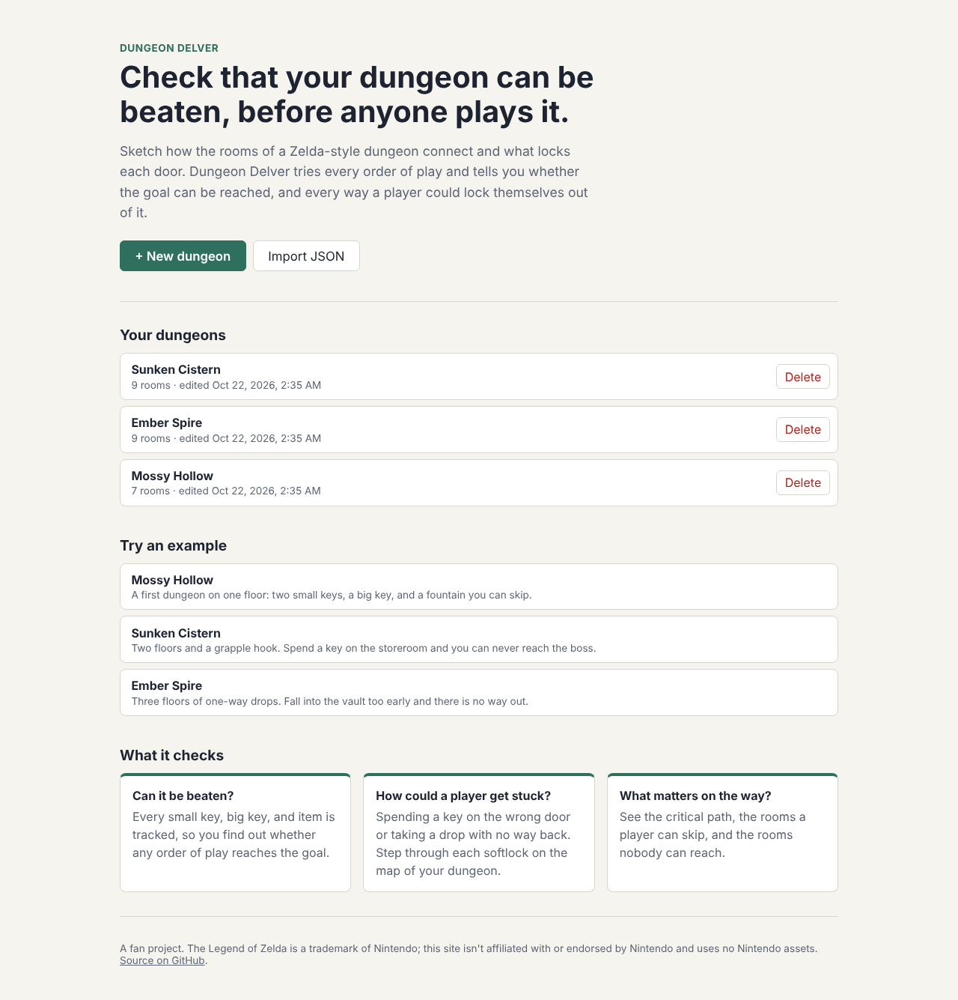
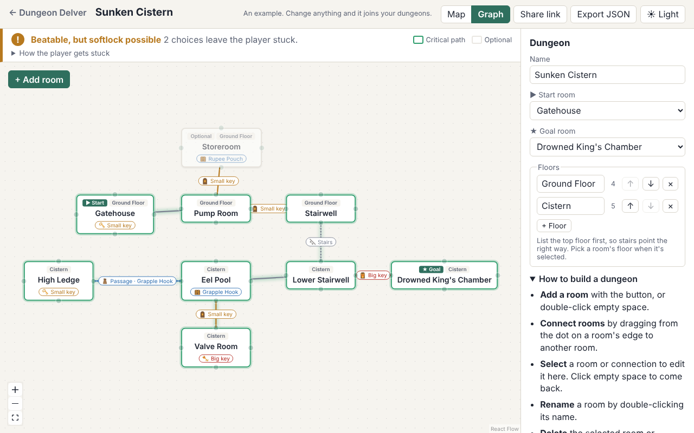
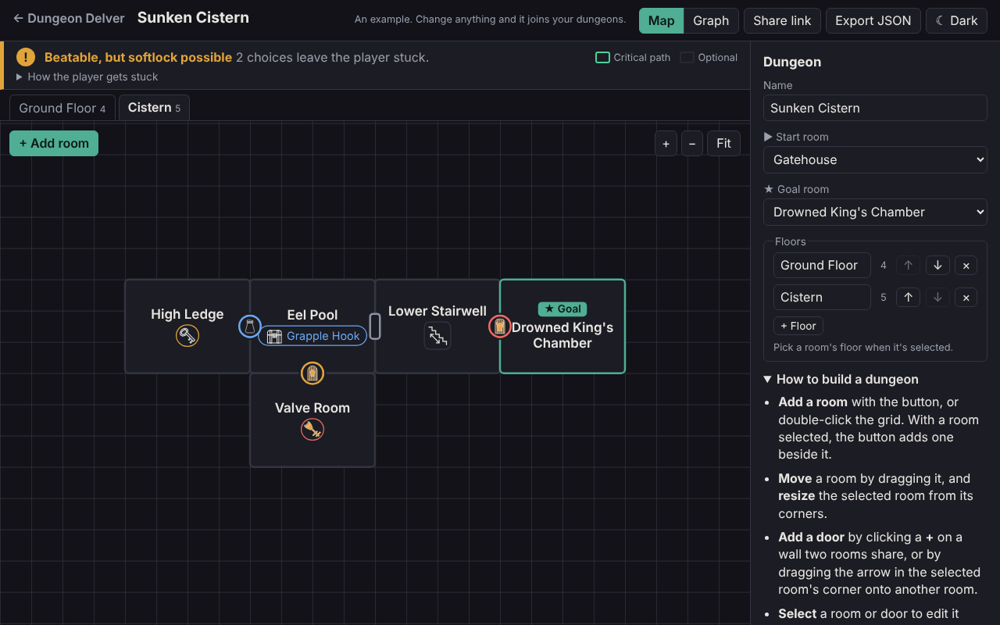
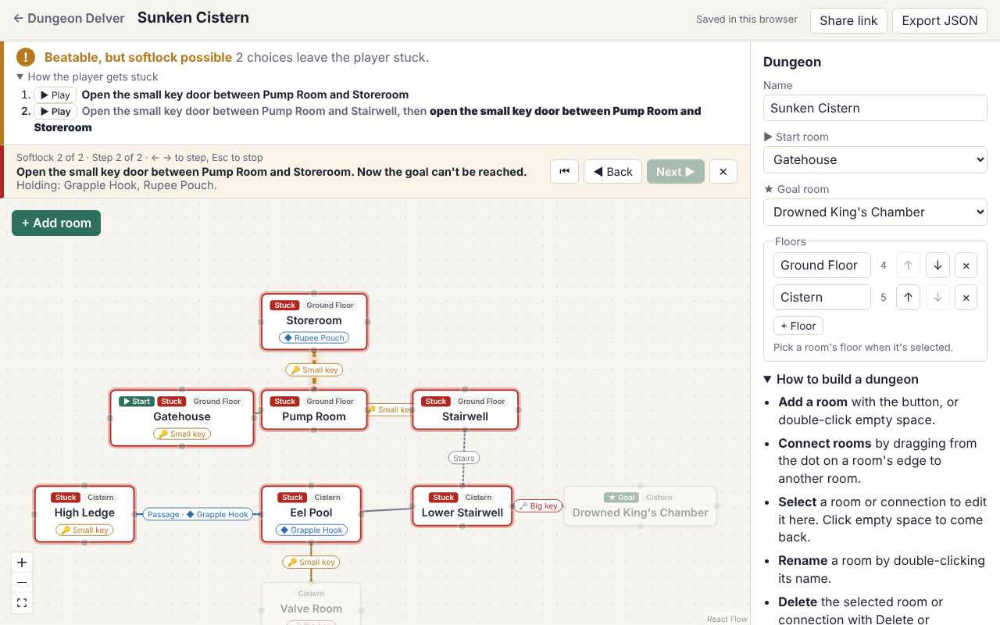
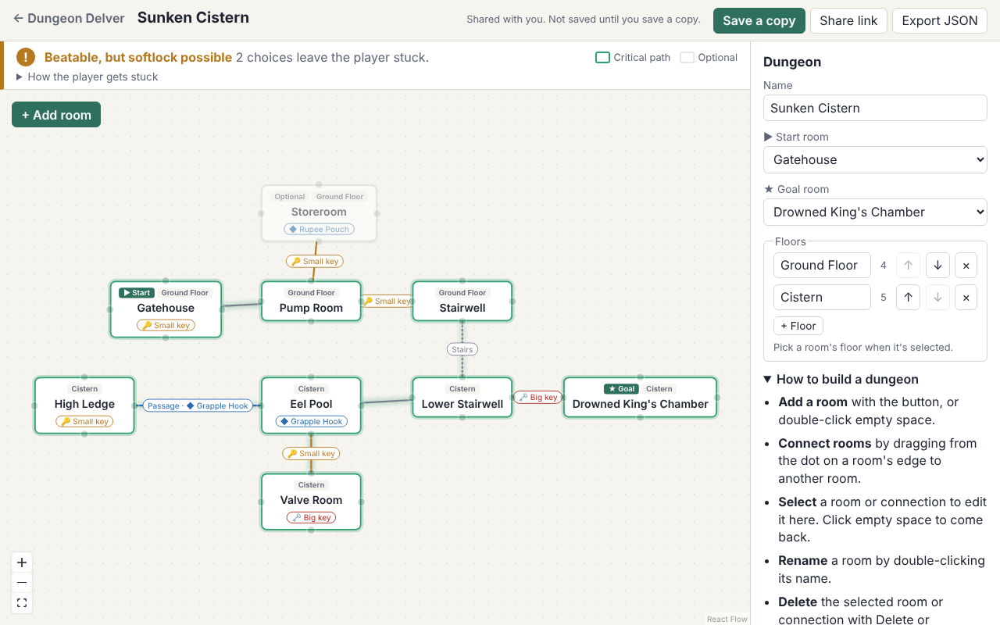

# Dungeon Delver

Exploring custom Zelda dungeons and whether they would work.

Sketch how a dungeon's rooms connect and what locks each connection (small keys, the big key, items like the hookshot, puzzles, one-way drops). Dungeon Delver tells you whether the dungeon can be beaten, how a player could softlock, which rooms are optional, and what the critical path is.

It's a static site, hosted on GitHub Pages, with no accounts and no server. Version 0.1 was the graph editor; the map view is nearly done, and the plan after that is to grow it into a dungeon building tool for tabletop RPGs (see [Roadmap](#roadmap)).



## Features

- **Lay out the dungeon as a map.** The builder opens on the map: one floor at a time, with rooms as rectangles on a snap grid. Drag rooms to move them, drag a corner to resize, and double-click the grid to add a room. Rooms connected on the same floor sit side by side with a door in their shared wall, marked with its lock's icon. Stairs and holes to other floors show inside their room, with arrows for one-way stairs; click one to jump to the room it leads to. Add a door by clicking the **+** on a shared wall or dragging the arrow in a selected room's corner onto another room, and when you put a room against another the map offers to add one. Rooms that have never been on the map are placed automatically, beside the rooms they connect to. Solver highlights on the map are still to come.
- **Puzzle locks.** A connection can be locked by a puzzle solved inside one of its rooms, like a shutter that opens once you solve the room. It opens from that side only, then stays open both ways, so the solver can tell when a drop or a key choice leaves the player on the wrong side. A puzzle on the door itself (like a lockpicking minigame) can be solved from either side.
- **Or build it as a graph.** Switch from Map to Graph to add, rename, move, and delete rooms as nodes, and drag between them to connect them. The side panel edits a room's contents (small keys, the big key, named items) or a connection's lock (small key, big key, item, puzzle) and kind (door, stairs, drop, passage, one-way). Pick the start and goal rooms, and sort rooms into floors.
- **Light and dark themes.** The site follows your system setting until you pick one with the toggle in the header.
- **Live results.** The solver re-checks the dungeon as you edit. A banner says whether it's beatable and how a player could get stuck, and the canvas highlights the critical path, optional rooms, and unreachable rooms.
- **Softlock playback.** Step through each way a player can get stuck, one door or drop at a time, and see which rooms they're trapped in.
- **Saved in your browser.** Dungeons save themselves in `localStorage`, several at once, and are listed on the front page.
- **Share links.** "Share link" copies a link with the whole dungeon packed into it (compressed with `lz-string`), so nothing is uploaded anywhere. Whoever opens it can look, edit, and save their own copy.
- **JSON export and import**, for backups and for moving dungeons between browsers.
- **Three example dungeons** to try: a gentle first one, a key softlock, and a one-way drop trap. An example joins your dungeons only once you change it.









## Roadmap

**Done**

- Phase 0 and 1: the dungeon format and the solver, tested against hand-made fixture dungeons.
- Phase 2 (v0.1): the graph editor, live results, softlock playback, saves, share links, JSON export, and examples.
- Phase 3, most of it: the map view, doors in shared walls, clickable stairs and holes between floors, the drawn icons, and puzzle locks. The light and dark themes from Phase 4 are done too.

**Next, for 1.0**

- Solver highlights on the map (critical path, optional rooms, softlock playback), as the graph already has.
- Polish: keyboard shortcuts, a phone layout for viewing and playback, and a short explanation of how the solver works.

**After 1.0: a dungeon builder for tabletop RPGs**

The solver stays the core, but the tool grows from checking Zelda-style dungeons into building dungeons to run at the table. Planned, roughly in order:

- **Your own locks and items.** Lock and item types are already data, not hard-coded Zelda rules, so a table can rename them (a "resource" instead of a small key, a "capability" instead of an item) and add their own.
- **Room notes.** Descriptions, encounters, treasure, traps, and puzzle details for each room, kept with the map.
- **Game master and player views.** Hide secret doors, notes, and unvisited rooms from the player view.
- **Switches and state.** Levers, crystal switches, and water levels that open and close more than one way, as flags in the solver's state.
- **Map export** as an image or a printable page.
- **A generator** that only produces dungeons that can be beaten without softlocks.

None of this needs a server: it stays a static site with saves in the browser and share links.

## Development

```sh
npm install
npm run dev     # local dev server
npm test        # unit tests (Vitest)
npm run lint    # oxlint
npm run build   # production build in dist/
```

Pushes to `main` run lint, tests, and the build, then deploy to GitHub Pages.

## Project layout

| Path | What it holds |
| --- | --- |
| `src/model/` | Dungeon format, validation, defaults, version migration. See [its README](src/model/README.md). |
| `src/solver/` | Pure solver logic and its tests |
| `src/solver/__fixtures__/` | Test dungeons as JSON, with the results the solver should give |
| `src/components/graph/` | The React Flow graph editor |
| `src/components/map/` | The SVG map editor, its pure grid geometry (`grid.js`), and where doors, stairs, and holes go (`doors.js`) |
| `src/assets/icons/` | The icon drawings, as SVG |
| `src/components/icons/` | Loads the drawings and recolors them for the theme (`parse.js`), and picks which icon stands for which lock, item, or passage (`icons.js`) |
| `src/components/panels/` | The side panel (selected room or connection, or the dungeon's start, goal, and floors), the solver results banner, and softlock playback |
| `src/components/results.js` | Turns solver results into banner text, highlights, and playback marks |
| `src/pages/` | The landing page and the builder |
| `src/routing.js` | Hash routing (`#/`, `#/edit/<id>`, `#/share/<data>`), so every page works on GitHub Pages |
| `src/storage/` | Saved dungeons in `localStorage`, share links, and JSON export |
| `src/examples/` | The example dungeons on the front page, with tests that they show what their blurbs promise |
| `docs/screenshots/` | Screenshots for this README |

## License

The code is under the license in [LICENSE](LICENSE).

The icons in `src/assets/icons/` are original drawings by [@NightMarethyu](https://github.com/NightMarethyu). The app recolors them to suit the theme but doesn't change their shapes.

The Legend of Zelda is a trademark of Nintendo. This is an unofficial fan project and is not affiliated with or endorsed by Nintendo. It uses no Nintendo assets.
